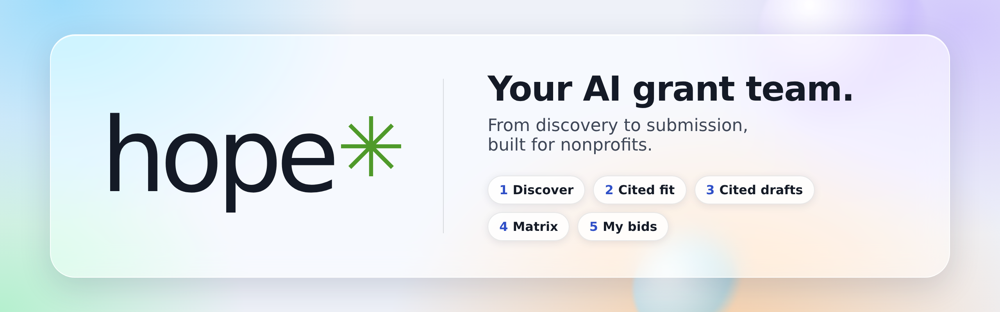

<p align="center">
  
</p>

<p align="center">
  <a href="https://hope-carolbonk.vercel.app/"></a>
  <a href="https://www.youtube.com/watch?v=O9q-CR2DaNc"></a>
</p>

# Hope

Multi-agent grant automation platform for non-profits. Specialist agents discover and parse
grant opportunities, score them against an agency's mission and capacity, build compliant
budgets, and draft applications. Humans approve every commitment through explicit
approval gates.

- Architecture: [`docs/architecture/blueprint.md`](docs/architecture/blueprint.md)
- Working rules and folder ownership: [`AGENTS.md`](AGENTS.md)

## Watch the walkthrough

<p align="center">
  <a href="https://www.youtube.com/watch?v=O9q-CR2DaNc">
    
  </a>
  <br>
  <sub>Click to watch on YouTube</sub>
</p>

## Quick start

```bash
pip install uv            # or see https://docs.astral.sh/uv/
uv sync --all-packages
pnpm install
docker compose -f infra/docker-compose.yml up -d   # Postgres+pgvector, Redpanda, Redis, Temporal, MinIO
uv run hope-migrate
uv run pytest -q
```

## Stack

Python 3.12 (Pydantic, FastAPI, Temporal, LangGraph-style agents behind `ModelGateway`),
Postgres 16 with RLS and pgvector, Kafka API (Redpanda locally), Redis, S3 (MinIO locally),
Next.js for the web app. Pydantic models in `hope_core.schemas` are the single source of truth
for contracts; JSON Schema and TypeScript types are generated from them.

## License

Proprietary. Copyright (c) 2026 Carolaine Bonk. All rights reserved. See [LICENSE](LICENSE).
