# Hope: Multi-Agent Grant Automation Platform

> **Long-term architecture, not the hackathon build.** Its pipeline agents (A0-A12), Temporal lifecycle, HITL gates, budget engine and Kafka flows are out of scope for H0-H5. Hackathon agents follow `docs/specs/README.md` (H0-H5) and `AGENTS.md` "Hackathon scope".

## Technical Blueprint & Architecture Specification

| Field | Value |
|---|---|
| Document | Technical Blueprint & Architecture Specification |
| Version | 1.0 (draft for review) |
| Author role | CTO & AI Systems Architect |
| Audience | Engineering, ML, Security, Product, Non-profit Operations |
| Status | Proposed |

---

## 0. Executive Summary

Hope is a multi-tenant platform that finds, qualifies, plans and drafts grant applications for non-profits. Specialist AI agents do the work, a deterministic workflow engine keeps the process safe, and humans approve every commitment the agency makes.

The key design decisions:

1. **Durable outer workflow, agentic inner steps.** Grant lifecycles run for weeks and stop at human approvals for days. **Temporal** runs the long-lived, crash-safe workflow (one per agency-opportunity pair). **LangGraph** runs the reasoning graph inside each agent step. Agents never own lifecycle state. The workflow does.
2. **One Core Pillar for routing.** All inbound data (opportunities, documents, profile changes) and outbound packages (application packages, notifications, CRM updates) pass through one **Grant Operations Pillar (GOP)**. The GOP is a Kafka event backbone with an API gateway, a schema registry, a transactional outbox and a canonical state store.
3. **LLMs suggest, deterministic code decides.** Eligibility gates, budget arithmetic, cap enforcement, deadline maths and submission validation are plain code. LLMs extract, classify, reason about fit and write prose. Every figure in a generated document comes from a ledger computed by code.
4. **Structured facts are the source of truth.** The Agency Profile lives in Postgres with versions and provenance. The vector store is only a retrieval index over documents. It is never the authority for a fact.
5. **Five HITL gates.** Go/No-Go, Budget sign-off, Compliance attestation, Executive/Board approval and Submission authorization. Each gate is a Temporal signal with role-based routing, SLA timers and an escalation chain.
6. **RFP content is untrusted input.** Ingested documents are treated as possibly hostile (prompt injection) and as possibly broken (malformed structure). Both cases have explicit fallback routes.

### 0.1 Assumptions (please confirm)

| # | Assumption | Effect if wrong |
|---|---|---|
| A1 | The "designated core architectural pillar" is a central **Grant Operations Pillar** (event bus, state and API contracts) that the platform owns. | Section 7 defines the pillar behind a `PillarPort` interface. If the pillar is an existing enterprise system (for example a Salesforce org or a data platform), only the adapter changes. |
| A2 | SaaS, multi-tenant, US-first (Grants.gov, SAM.gov, 2 CFR 200). | International funders need more connectors and compliance rule packs. |
| A3 | The platform drafts and packages applications. A human authorized representative (AOR) always does or authorizes the final submission. | Fully automatic submission is out of scope for v1 on purpose. |
| A4 | Cloud: AWS reference build (portable to GCP/Azure). | Managed service names change. The architecture does not. |

---

## 1. System Context

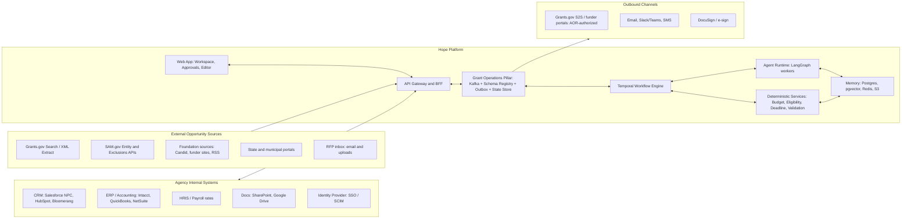

---

## 2. Agent Architecture & Specialist Taxonomy

### 2.1 Taxonomy Overview

The agents are grouped into four tiers. Agents talk only through typed messages on the pillar or through workflow activities. They never call each other directly, so every hop is logged, replayable and governed by policy.

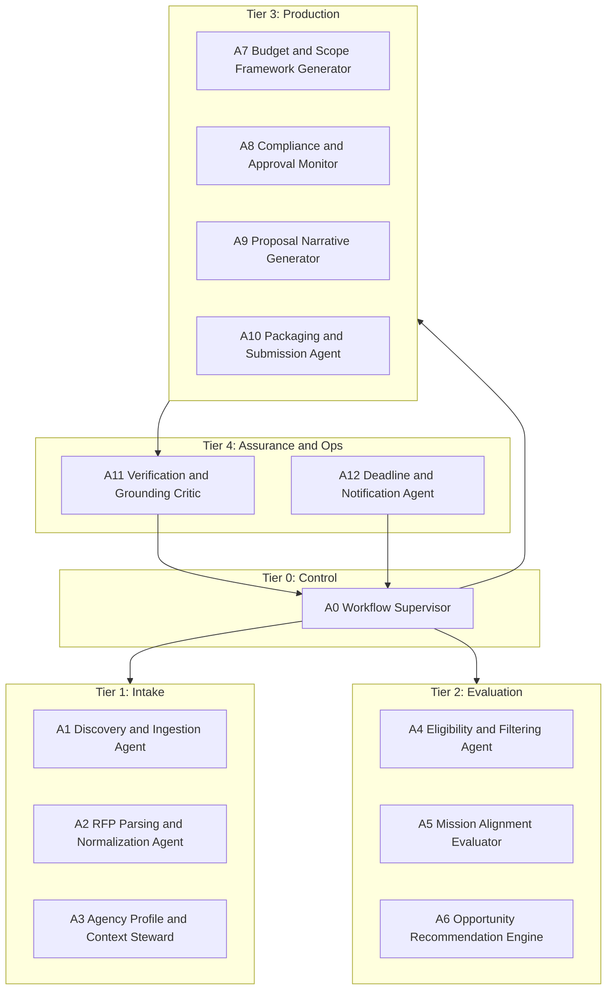

### 2.2 Agent Specification Cards

Autonomy levels: **L1** = deterministic tool only. **L2** = LLM with schema-constrained output, no side effects. **L3** = LLM with side-effecting tools behind policy. **L4** = needs HITL before any side effect.

#### A0. Workflow Supervisor (Orchestrator)
| Aspect | Specification |
|---|---|
| Purpose | Runs the per-opportunity lifecycle: dispatches agent tasks, enforces state transitions, opens HITL gates, handles retries and compensation. |
| Inputs | `opportunity.normalized`, `profile.updated`, `hitl.decision`, agent result events, timers. |
| Outputs | Agent task commands, `opportunity.state_changed`, `hitl.requested`, escalations. |
| Stack | **Temporal workflow code (deterministic, no LLM in the control path).** An optional LLM "planner" may *suggest* the next action for exception handling. Code validates the suggestion against the state machine before acting. |
| Memory | Temporal event history (durable execution state). Pointer to the LangGraph checkpoint for each agent run. |
| Autonomy | L1 |
| Failure handling | Activity retries with exponential backoff. Saga compensation (for example, release a reserved budget draft). Dead-letter to the ops queue after N failures. |

#### A1. Discovery & Ingestion Agent
| Aspect | Specification |
|---|---|
| Purpose | Pulls opportunities from all sources on a schedule or by webhook, removes duplicates, and stores raw artifacts. |
| Inputs | Connector schedules, saved searches per agency (CFDA/ALN codes, keywords, geography), email inbox, manual uploads, URLs. |
| Outputs | `opportunity.raw_ingested` event and immutable raw artifacts in S3 (PDF, DOCX, HTML, XML) with SHA-256 content hash. |
| Stack | Connector SDK (Python), Grants.gov REST + XML extract, SAM.gov APIs, Playwright crawler for portals without APIs (robots.txt and ToS allow-list), IMAP/Graph mail ingest. A small LLM (classifier) flags "is this an RFP?" for email and web pages. |
| Dedup | Composite key `(source, source_id)`, plus near-duplicate detection with MinHash over normalized text and embedding cosine > 0.95 to merge cross-posted opportunities. |
| Memory | Connector cursors and ETags in Postgres. Fetch cache in Redis. |
| Autonomy | L3 (read-only side effects: fetching) |

#### A2. RFP Parsing & Normalization Agent
| Aspect | Specification |
|---|---|
| Purpose | Turns unstructured RFP/RFT documents into the canonical `GrantOpportunity` schema (Section 5.2), with field-level provenance and confidence. |
| Inputs | Raw artifacts and source metadata. |
| Outputs | `opportunity.normalized` (schema-valid), or `opportunity.parse_incomplete` with a list of missing or low-confidence fields. |
| Stack | **Layout-aware parsing pipeline:** (1) native text extraction (pdfplumber, python-docx); (2) layout model (Docling / Unstructured / AWS Textract) for tables and sections; (3) OCR fallback for scans; (4) LLM structured extraction with **function calling / JSON-schema-constrained decoding**, run section by section; (5) a fine-tuned small model (LoRA on an 8B-class open model) for high-volume field classification (eligibility type, cost-share flags) to cut cost. |
| Provenance | Each extracted field stores `{value, confidence, source_artifact_id, page, char_span, extractor}`. A field without provenance is rejected. |
| Memory | Short-term: per-document chunk cache. Long-term: funder "template memory" (layouts seen before for each funder and NOFO family) to speed up and stabilize extraction. |
| Autonomy | L2 |

#### A3. Agency Profile & Context Steward
| Aspect | Specification |
|---|---|
| Purpose | Keeps the dynamic Agency Profile current: mission, vision, tax status, budget scale, past grants, demographics, programs, approval hierarchy, compliance calendar. |
| Inputs | Onboarding wizard, uploaded docs (990s, audits, annual reports, strategic plans), CRM/ERP syncs, award outcomes, user edits. |
| Outputs | `profile.updated` (versioned diff), profile completeness score, `profile.stale_field` alerts (for example, an expired audit or a lapsed SAM registration). |
| Stack | Extraction LLM with schema output. Deterministic validators (EIN format, UEI checksum and SAM status lookup, fiscal-year math). Embedding pipeline that indexes narrative assets (boilerplate, outcomes, bios) into pgvector. |
| Rule | **The LLM may only propose profile changes.** Changes to protected fields (financials, tax status, signatories, indirect rate) need human confirmation (HITL-0). |
| Memory | Long-term system of record (Postgres, bitemporal versions). Semantic store of narrative assets. |
| Autonomy | L2 to propose, L4 to commit protected fields |

#### A4. Eligibility & Filtering Agent
| Aspect | Specification |
|---|---|
| Purpose | Hard-gates opportunities with deterministic rules, then soft-filters by deadline feasibility and effort-to-funding ratio. |
| Inputs | `GrantOpportunity`, `AgencyProfile`, agency capacity calendar. |
| Outputs | `EligibilityResult {status: eligible / ineligible / needs_review, failed_rules[], evidence[]}` and an `EffortEstimate`. |
| Stack | **Rules engine (JSON Logic / OPA Rego)** for hard criteria: entity type, 501(c)(3), geography, budget band, registrations (SAM/UEI), cost-share ability. An LLM is used **only** to turn free-text eligibility clauses into rule expressions. A human or the verifier must approve a new rule before it is used. Effort model: gradient-boosted regressor on past application hours, with features such as page limits, attachment count and narrative sections. |
| Effort-to-Funding | `EFR = expected_hours / (award_ceiling * p_win)`. Configurable cut-off per agency. |
| Autonomy | L1 / L2 |

#### A5. Mission Alignment Evaluator
| Aspect | Specification |
|---|---|
| Purpose | Scores how well the agency's mission, programs and outcomes fit the grantor's intent and priorities. |
| Inputs | Normalized funding priorities, evaluation criteria, grantor history (past awardees from 990-PF / USAspending), agency profile and program library. |
| Outputs | `AlignmentAssessment {score 0-100, dimension_scores, matched_programs[], gaps[], rationale with citations}`. |
| Stack | **Hybrid RAG**: BM25 + dense retrieval over the agency program library and the funder corpus, then a cross-encoder reranker. LLM-as-judge with a **fixed rubric** (theory of change, population, geography, outcomes, organizational capacity, funder relationship) and per-dimension scores. Each score must cite evidence span IDs. Self-consistency: 3 samples, median taken. If variance is above a threshold, the result is marked `low_confidence`. |
| Calibration | Scores are calibrated against historical win/loss with isotonic regression, so "75" means the same thing across funders. |
| Autonomy | L2 |

#### A6. Opportunity Recommendation Engine
| Aspect | Specification |
|---|---|
| Purpose | Keeps scoring, ranking and suggesting active opportunities for each agency's profile and capacity. |
| Inputs | Eligible opportunities, alignment assessments, effort estimates, capacity calendar, outcome feedback (won, lost, declined, ignored). |
| Outputs | `OpportunityMatrix` (Section 5.3), ranked feed, weekly digest, "new high-fit" alerts. |
| Stack | Stage 1: candidate generation with a two-tower embedding (agency vector vs. opportunity vector) in pgvector/Qdrant. Stage 2: feature-based ranking (heuristic weights at cold start, then **LightGBM LambdaMART** learning-to-rank once there are at least 200 labeled outcomes per segment). Stage 3: capacity-aware portfolio selection (greedy knapsack on staff-hours and deadlines). An LLM writes only the human-readable "why this is recommended" text, from the computed features. |
| Triggers | Re-score on `opportunity.normalized`, `profile.updated`, `capacity.changed`, and a nightly sweep. |
| Autonomy | L1 / L2 |

#### A7. Budget & Scope Framework Generator
| Aspect | Specification |
|---|---|
| Purpose | Builds the project framework (goals, objectives, activities, timeline, logic model) and a budget that complies with grantor caps. |
| Inputs | Approved opportunity, matched programs, cost basis from ERP/HRIS (salary rates, fringe rate, negotiated or de minimis indirect rate), grantor budget rules (ceiling, floor, cost share, unallowable costs, indirect cap). |
| Outputs | `ProposalFramework` (Section 5.4), with `BudgetLedger` produced **only** by the deterministic Budget Engine. |
| Stack | LLM proposes **structure**: line-item categories, quantities as references to cost-basis records, and justification text. **Budget Engine** (Python `Decimal`, rounding rules, SF-424A category mapping) computes every amount. **Constraint solver** (OR-Tools / linear programming) fits the budget under ceilings, indirect caps and cost-share ratios when the first draft is over limits. |
| Autonomy | L2 (draft). L4 for commit (HITL-2 Finance sign-off). |

#### A8. Compliance & Approval Monitor
| Aspect | Specification |
|---|---|
| Purpose | Tracks compliance requirements, registrations, certifications, required attachments, and multi-level internal approvals. Raises risks early. |
| Inputs | Opportunity requirements, agency compliance calendar (SAM expiry, audit dates, insurance), approval hierarchy, draft package. |
| Outputs | `ComplianceChecklist` (each item pass / fail / pending with evidence), `approval.route` plan, risk flags. |
| Stack | Rule packs (2 CFR 200, Grants.gov package forms, funder-specific packs) in OPA. LLM maps free-text requirements to checklist items and checks drafts against them (for example "page limit 10", "font 12pt", "must address Criterion C"). Deterministic document checks (page count, fonts, file types, file-size limits, PDF/A). |
| Autonomy | L2 to evaluate, L4 for attestations (HITL-3) |

#### A9. Proposal Narrative Generator
| Aspect | Specification |
|---|---|
| Purpose | Drafts narrative sections mapped one-to-one to the funder's evaluation criteria and required sections. |
| Inputs | Locked `ProposalFramework`, approved boilerplate library, program outcomes data, RFP section requirements and scoring rubric, agency voice and style guide. |
| Outputs | Section drafts with citations to agency evidence, a compliance matrix (criterion to section to paragraph), and placeholders for every figure. |
| Stack | RAG over the agency's approved content library (only items marked `approved_for_reuse`). Long-context LLM. **Numeric placeholders**: the model writes `{{budget.total_request}}` and `{{outcome.youth_served_2024}}`, and the renderer fills values from the ledger and the profile. The model is never allowed to type raw numbers. Optional per-agency style adapter (LoRA) trained only on that agency's opted-in past winning proposals. |
| Autonomy | L2 |

#### A10. Packaging & Submission Agent
| Aspect | Specification |
|---|---|
| Purpose | Assembles the final package (SF-424 family forms, narratives, budget, attachments), validates it, and stages submission. |
| Inputs | Approved narrative and budget, attachments, submission channel metadata. |
| Outputs | `application.package_ready` (signed manifest + hash), submission receipt or tracking number after AOR authorization. |
| Stack | Deterministic form fillers (Grants.gov forms XML), PDF assembly, schema validation against the funder package, Grants.gov S2S client (SOAP / mTLS) where the agency has S2S registration. Otherwise a guided manual-submission kit. |
| Autonomy | L4: **only runs after HITL-5 submission authorization by the AOR.** |

#### A11. Verification & Grounding Critic
| Aspect | Specification |
|---|---|
| Purpose | Independent checker that every LLM output is grounded, consistent and in policy before it reaches a human or moves state forward. |
| Inputs | Any agent output plus its cited evidence. |
| Outputs | `VerificationReport {pass/fail, unsupported_claims[], numeric_mismatches[], policy_violations[]}`. |
| Stack | Different model family from the generator (lowers correlated errors). NLI entailment check of claim vs. cited span. Numeric reconciliation (regex + parser extracts every number in the rendered output and reconciles it against the ledger and profile). PII and confidentiality scanner (Presidio). Prompt-injection detector on ingested content. |
| Autonomy | L2 (can block, cannot edit) |

#### A12. Deadline & Notification Agent
| Aspect | Specification |
|---|---|
| Purpose | Works backward from each deadline to build internal milestones. Sends reminders, escalations and digests. |
| Inputs | Deadlines (in the funder's timezone), internal buffers (for example, Grants.gov submission 72h early, since registration and validation problems are common), approval SLAs, user preferences. |
| Outputs | Calendar milestones (ICS / Graph / Google), notifications, escalation events. |
| Stack | Deterministic scheduler (Temporal timers), notification service (SES/SendGrid, Slack/Teams, Twilio), LLM for digest summaries only. |
| Autonomy | L1 / L3 |

### 2.3 Agent I/O and Tooling Matrix (summary)

| Agent | Primary input event | Primary output event | LLM tier | RAG | Vector DB | Function calling | Fine-tuned model | Deterministic core |
|---|---|---|---|---|---|---|---|---|
| A0 Supervisor | all | `*.command`, `opportunity.state_changed` | none (optional planner) | - | - | - | - | Temporal workflow |
| A1 Discovery | schedule, webhook | `opportunity.raw_ingested` | small | - | dedup index | yes | RFP classifier | connectors, MinHash |
| A2 Parser | `opportunity.raw_ingested` | `opportunity.normalized` | frontier + small | funder templates | yes | JSON-schema output | field classifier (LoRA) | validators |
| A3 Profile | `profile.source_uploaded` | `profile.updated` | mid | profile docs | yes | yes | - | EIN/UEI/FY validators |
| A4 Eligibility | `opportunity.normalized` | `opportunity.eligibility_evaluated` | small (rule drafting) | - | - | yes | - | OPA / JSON Logic |
| A5 Alignment | `opportunity.eligibility_evaluated` | `opportunity.alignment_scored` | frontier | hybrid + rerank | yes | rubric output | - | calibration |
| A6 Recommender | scored events | `recommendation.updated` | small (explanations) | - | two-tower | - | LTR model | knapsack |
| A7 Budget | `opportunity.go_approved` | `framework.drafted` | frontier | cost basis | - | yes | - | Budget Engine, OR-Tools |
| A8 Compliance | `framework.*`, `draft.*` | `compliance.evaluated` | mid | rule packs | yes | yes | - | OPA, doc checks |
| A9 Narrative | `framework.locked` | `draft.section_ready` | frontier long-context | content library | yes | placeholders | style LoRA (opt-in) | template renderer |
| A10 Packaging | `submission.authorized` | `application.submitted` | none | - | - | - | - | forms XML, S2S client |
| A11 Verifier | any `*.ready` | `verification.reported` | frontier (different vendor) | evidence | yes | yes | NLI model | numeric reconciler |
| A12 Deadlines | `opportunity.*`, timers | `notification.requested` | small | - | - | - | - | scheduler |

**Model routing.** A `ModelGateway` service (LiteLLM-style) maps the logical tiers (`frontier`, `mid`, `small`, `embed`, `rerank`) to concrete providers. It handles per-tenant data-residency rules, zero-data-retention endpoints, cost budgets, and automatic failover across at least two vendors.

---

## 3. Memory Architecture

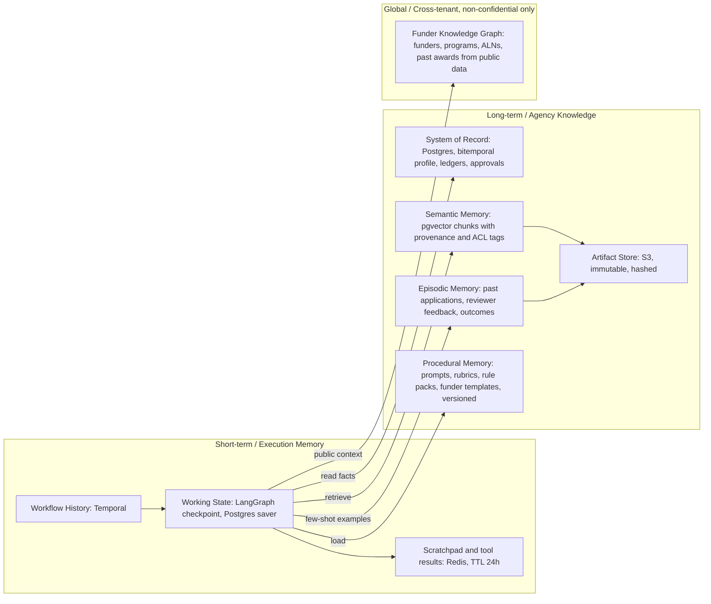

| Layer | Store | Scope | Retention | Write rules |
|---|---|---|---|---|
| Working state | LangGraph checkpointer (Postgres) | one agent run | 30 days, for replay and debug | agent writes freely |
| Scratchpad | Redis | one activity | TTL 24h | agent writes freely, never trusted as fact |
| Workflow history | Temporal | one opportunity lifecycle | 1 year after close | workflow only |
| System of record | Postgres + RLS | tenant | life of tenant plus legal hold | **validated writes only.** Protected fields need HITL. |
| Semantic memory | pgvector (to Qdrant beyond about 50M chunks) | tenant, ACL tags per chunk | follows source doc | ingestion pipeline only |
| Episodic memory | Postgres + S3 | tenant | configurable | written on outcome events |
| Procedural memory | Git-backed prompt and rule registry | global or tenant override | versioned forever | PR review plus eval gate |
| Funder graph | Postgres (graph tables) or Neo4j | global | refreshed nightly | public sources only |

**Context assembly.** Each agent gets a context through a `ContextBuilder`. It (1) loads the structured facts it needs from the system of record, as JSON with field IDs; (2) retrieves the top-k chunks under the caller's ACL; (3) adds procedural assets (prompt version, rubric version); and (4) records a **context manifest** (IDs and versions of everything loaded), so any output can be reproduced and audited.

---

## 4. Workflow Orchestration & Data Flow

### 4.1 Orchestration Protocol Choice

| Option | Strengths | Weaknesses | Decision |
|---|---|---|---|
| LangGraph only | Great agent graphs, checkpoints, interrupts | Weak for weeks-long timers, cross-service sagas, ops tooling | **Inner loop** |
| AutoGen / CrewAI | Fast prototyping of conversational multi-agent setups | Free-form agent chat is hard to audit and to bound in cost | Not used in production. Fine for R&D. |
| Custom DAG (Airflow / Dagster) | Good for batch | Poor at event-driven HITL waits | Used only for batch ETL (funder graph refresh) |
| **Temporal + LangGraph** | Durable execution, signals for HITL, timers, retries, versioning. LangGraph handles the reasoning inside activities. | Two frameworks to learn | **Selected** |

**Protocol rules.**
1. One **`OpportunityLifecycleWorkflow`** per `(tenant_id, opportunity_id)`. Its ID is deterministic, so duplicate starts are idempotent.
2. Agents run as **Temporal activities** on dedicated task queues (`q.parse`, `q.align`, `q.budget` ...), so each can scale on its own.
3. Inside an activity, the agent runs a LangGraph graph (plan, retrieve, act, self-check), bounded by a step budget, token budget and wall-clock timeout.
4. Every activity result is a **typed envelope** (Section 5.5). The workflow validates it against JSON Schema before any transition.
5. Every state transition is published to the pillar (`opportunity.state_changed`) through the transactional outbox.

### 4.2 End-to-End Trace: Discovery to Mission Alignment to Budgeting to HITL Approval to Application Generation

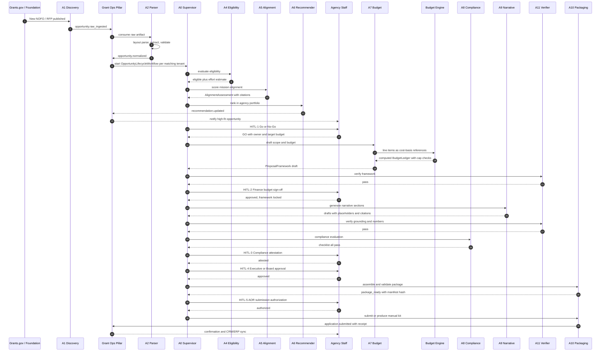

### 4.3 Opportunity Lifecycle State Machine

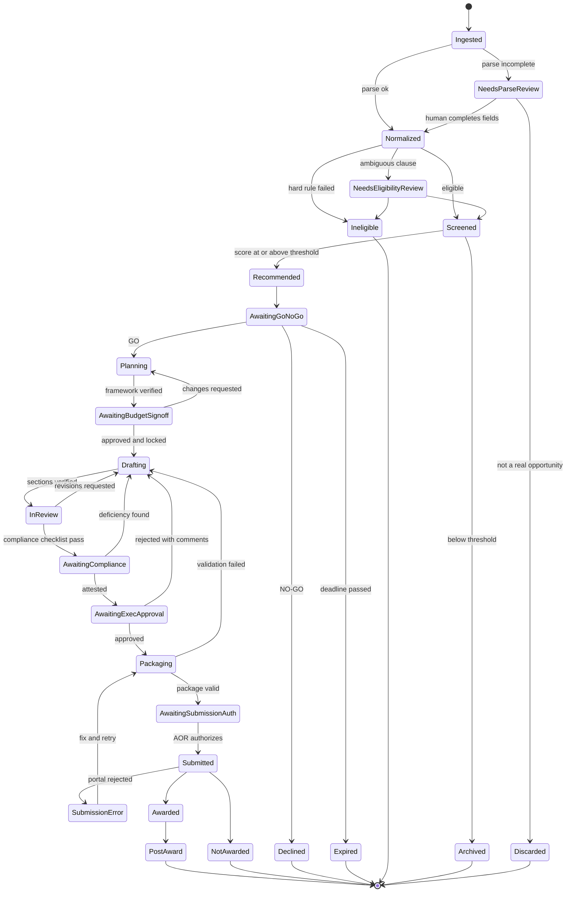

**Global transition guards (enforced in workflow code):**
- Any non-terminal state goes to `Expired` when `now > internal_deadline` and the opportunity is not yet `Submitted`. An escalation fires at T-72h and T-24h first.
- `profile.updated` on a protected field while in `Planning` through `Packaging` sends a `revalidate` signal. Eligibility, budget and compliance re-run, and any affected approvals are invalidated.
- An RFP amendment (`opportunity.amended`) re-parses and diffs. If the diff touches budget, eligibility or required sections, the workflow goes back to the earliest affected state and tells the owners.

### 4.4 Human-in-the-Loop Checkpoints

| Gate | When | Approver role(s) | What they see | Decision options | SLA / escalation |
|---|---|---|---|---|---|
| **HITL-0** Profile commit | Protected profile field changes | Org Admin / Finance | Field diff, source document, extraction confidence | approve, edit, reject | 3 business days, then Admin |
| **HITL-1** Go / No-Go | Opportunity recommended | Development Director (owner) + Program Lead | Opportunity matrix row, alignment rationale with citations, effort estimate, capacity impact, deadline plan | GO (assign owner, target ask), NO-GO (reason code, which feeds the recommender), DEFER | 5 days or 20% of time to deadline, whichever is shorter |
| **HITL-2** Budget sign-off | Framework verified | Finance Director (CFO for asks above a threshold) | Ledger, cap compliance report, cost-basis sources, solver adjustments | approve and lock, request changes (inline) | 3 days, then CFO |
| **HITL-3** Compliance attestation | Compliance checklist complete | Compliance Officer | Checklist with evidence, registrations status, certifications | attest (e-signed), return with deficiencies | 2 days, then ED |
| **HITL-4** Executive / Board approval | Final draft | Executive Director. Board chair if the ask is above the board threshold set in the approval hierarchy. | Full package preview, red-line vs. last version, risk summary | approve, reject with comments | per hierarchy config |
| **HITL-5** Submission authorization | Package valid | AOR (Authorized Organization Representative) | Final manifest + hash, portal target, checklist | authorize submit, hold | must be before the internal deadline |

**Gate mechanics.** A gate is a Temporal `await signal` with a timer. The approval request carries the **content hash** of the artifact being approved. If the artifact changes after approval, the approval is void. Approvals are written to an append-only `approval_log` (who, role, timestamp, hash, IP or device, e-sign envelope ID). **Separation of duties:** the person who drafts a budget cannot be the HITL-2 approver, unless the tenant is marked a "small org" with explicit acknowledgement.

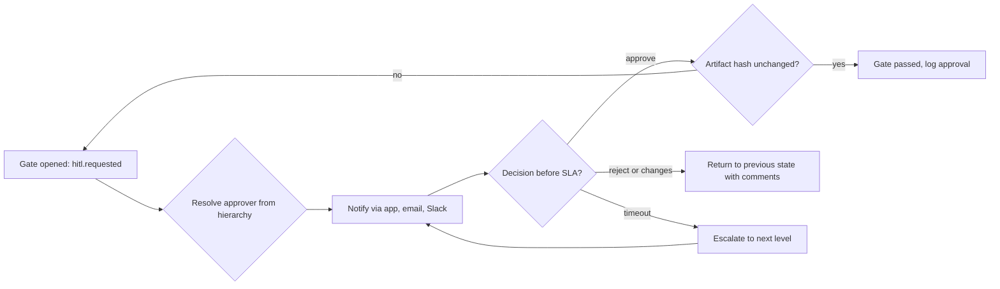

---

## 5. Data Schemas

All schemas are JSON Schema draft 2020-12 and live in the **Schema Registry** (Section 7). They follow semantic versioning: an additive change is a minor version, a breaking change is a major version with a dual-publish migration window. Money is **always** an integer of minor units (cents) plus an ISO-4217 currency. Floats are never used for money.

### 5.1 Agency Profile

```json
{
  "$schema": "https://json-schema.org/draft/2020-12/schema",
  "$id": "https://schemas.hope.dev/agency-profile/1.0.0",
  "title": "AgencyProfile",
  "type": "object",
  "required": ["agency_id", "tenant_id", "version", "legal", "mission", "financials", "approval_hierarchy"],
  "$defs": {
    "money": {
      "type": "object",
      "required": ["amount_minor", "currency"],
      "properties": {
        "amount_minor": { "type": "integer" },
        "currency": { "type": "string", "pattern": "^[A-Z]{3}$" }
      }
    },
    "provenance": {
      "type": "object",
      "required": ["source", "captured_at"],
      "properties": {
        "source": { "enum": ["user_input", "document_extraction", "crm_sync", "erp_sync", "sam_gov", "irs", "system"] },
        "source_ref": { "type": "string", "description": "artifact_id, record id or URL" },
        "captured_at": { "type": "string", "format": "date-time" },
        "verified_by": { "type": "string", "description": "user_id if confirmed by a human" },
        "confidence": { "type": "number", "minimum": 0, "maximum": 1 }
      }
    }
  },
  "properties": {
    "agency_id": { "type": "string", "format": "uuid" },
    "tenant_id": { "type": "string", "format": "uuid" },
    "version": { "type": "integer", "minimum": 1 },
    "valid_from": { "type": "string", "format": "date-time" },
    "legal": {
      "type": "object",
      "required": ["legal_name", "ein", "tax_status"],
      "properties": {
        "legal_name": { "type": "string" },
        "dba": { "type": "array", "items": { "type": "string" } },
        "ein": { "type": "string", "pattern": "^[0-9]{2}-[0-9]{7}$" },
        "uei": { "type": "string", "pattern": "^[A-Z0-9]{12}$" },
        "sam_registration": {
          "type": "object",
          "properties": {
            "status": { "enum": ["active", "expired", "pending", "none"] },
            "expires_on": { "type": "string", "format": "date" },
            "exclusions_flag": { "type": "boolean" }
          }
        },
        "tax_status": { "enum": ["501c3_public_charity", "501c3_private_foundation", "501c4", "501c6", "fiscally_sponsored", "government", "tribal", "other"] },
        "fiscal_sponsor_id": { "type": "string" },
        "state_of_incorporation": { "type": "string" },
        "provenance": { "$ref": "#/$defs/provenance" }
      }
    },
    "mission": {
      "type": "object",
      "required": ["mission_statement"],
      "properties": {
        "mission_statement": { "type": "string", "maxLength": 2000 },
        "vision_statement": { "type": "string", "maxLength": 2000 },
        "theory_of_change": { "type": "string" },
        "focus_areas": { "type": "array", "items": { "type": "string", "description": "NTEE code or controlled taxonomy term" } },
        "ntee_codes": { "type": "array", "items": { "type": "string" } }
      }
    },
    "financials": {
      "type": "object",
      "required": ["fiscal_year_end", "annual_operating_budget"],
      "properties": {
        "fiscal_year_end": { "type": "string", "pattern": "^(0[1-9]|1[0-2])-(0[1-9]|[12][0-9]|3[01])$" },
        "annual_operating_budget": { "$ref": "#/$defs/money" },
        "budget_band": { "enum": ["<250k", "250k-1m", "1m-5m", "5m-25m", ">25m"] },
        "indirect_rate": {
          "type": "object",
          "properties": {
            "type": { "enum": ["negotiated_nicra", "de_minimis", "none"] },
            "rate_bps": { "type": "integer", "description": "basis points, e.g. 1500 = 15%" },
            "base": { "enum": ["MTDC", "TDC", "salaries_wages"] },
            "agreement_expires_on": { "type": "string", "format": "date" }
          }
        },
        "fringe_rate_bps": { "type": "integer" },
        "last_audit": {
          "type": "object",
          "properties": {
            "type": { "enum": ["single_audit", "financial_audit", "review", "none"] },
            "fiscal_year": { "type": "integer" },
            "findings": { "type": "boolean" },
            "artifact_id": { "type": "string" }
          }
        },
        "provenance": { "$ref": "#/$defs/provenance" }
      }
    },
    "programs": {
      "type": "array",
      "items": {
        "type": "object",
        "required": ["program_id", "name", "description"],
        "properties": {
          "program_id": { "type": "string" },
          "name": { "type": "string" },
          "description": { "type": "string" },
          "status": { "enum": ["active", "pilot", "planned", "sunset"] },
          "annual_cost": { "$ref": "#/$defs/money" },
          "geography": { "type": "array", "items": { "type": "string", "description": "FIPS or ISO-3166-2 code" } },
          "target_demographics": {
            "type": "array",
            "items": {
              "type": "object",
              "properties": {
                "population": { "type": "string" },
                "age_range": { "type": "string" },
                "annual_served": { "type": "integer" }
              }
            }
          },
          "outcomes": {
            "type": "array",
            "items": {
              "type": "object",
              "required": ["metric_id", "label", "value", "period"],
              "properties": {
                "metric_id": { "type": "string" },
                "label": { "type": "string" },
                "value": { "type": "number" },
                "unit": { "type": "string" },
                "period": { "type": "string" },
                "provenance": { "$ref": "#/$defs/provenance" }
              }
            }
          }
        }
      }
    },
    "grant_history": {
      "type": "array",
      "items": {
        "type": "object",
        "required": ["funder_id", "outcome"],
        "properties": {
          "funder_id": { "type": "string" },
          "program_name": { "type": "string" },
          "aln": { "type": "string", "description": "Assistance Listing Number, e.g. 93.243" },
          "amount": { "$ref": "#/$defs/money" },
          "outcome": { "enum": ["awarded", "declined", "withdrawn", "pending"] },
          "period_start": { "type": "string", "format": "date" },
          "period_end": { "type": "string", "format": "date" },
          "reviewer_feedback_artifact_id": { "type": "string" }
        }
      }
    },
    "capacity": {
      "type": "object",
      "properties": {
        "grant_writer_fte": { "type": "number" },
        "monthly_hours_available": { "type": "integer" },
        "max_concurrent_applications": { "type": "integer" },
        "cost_share_capacity": { "$ref": "#/$defs/money" }
      }
    },
    "approval_hierarchy": {
      "type": "array",
      "description": "Ordered approval rules evaluated per gate",
      "items": {
        "type": "object",
        "required": ["gate", "approver_roles"],
        "properties": {
          "gate": { "enum": ["HITL-0", "HITL-1", "HITL-2", "HITL-3", "HITL-4", "HITL-5"] },
          "condition": { "type": "object", "description": "JSON Logic, e.g. request amount > 250000_00" },
          "approver_roles": { "type": "array", "items": { "type": "string" } },
          "min_approvals": { "type": "integer", "default": 1 },
          "sla_hours": { "type": "integer" },
          "escalate_to_role": { "type": "string" }
        }
      }
    },
    "compliance_calendar": {
      "type": "array",
      "items": {
        "type": "object",
        "required": ["item", "due_on"],
        "properties": {
          "item": { "enum": ["sam_renewal", "form_990", "single_audit", "state_charity_registration", "insurance_renewal", "nicra_renewal", "board_meeting", "custom"] },
          "due_on": { "type": "string", "format": "date" },
          "owner_user_id": { "type": "string" }
        }
      }
    },
    "data_governance": {
      "type": "object",
      "properties": {
        "allow_cross_tenant_learning": { "type": "boolean", "default": false },
        "allow_style_finetune": { "type": "boolean", "default": false },
        "data_residency": { "enum": ["us", "eu", "ca"] },
        "retention_days": { "type": "integer" }
      }
    }
  }
}
```

### 5.2 Grant Opportunity (normalized RFP / RFT)

```json
{
  "$schema": "https://json-schema.org/draft/2020-12/schema",
  "$id": "https://schemas.hope.dev/grant-opportunity/1.0.0",
  "title": "GrantOpportunity",
  "type": "object",
  "required": ["opportunity_id", "source", "title", "funder", "deadlines", "funding", "eligibility", "parse_quality"],
  "$defs": {
    "money": { "$ref": "https://schemas.hope.dev/agency-profile/1.0.0#/$defs/money" },
    "evidence": {
      "type": "object",
      "required": ["artifact_id", "page"],
      "properties": {
        "artifact_id": { "type": "string" },
        "page": { "type": "integer" },
        "char_start": { "type": "integer" },
        "char_end": { "type": "integer" },
        "quote": { "type": "string", "maxLength": 500 }
      }
    },
    "extracted": {
      "type": "object",
      "description": "Wrapper on every extracted field",
      "required": ["confidence", "evidence"],
      "properties": {
        "confidence": { "type": "number", "minimum": 0, "maximum": 1 },
        "evidence": { "type": "array", "items": { "$ref": "#/$defs/evidence" }, "minItems": 1 },
        "extractor": { "type": "string", "description": "model or parser id + version" }
      }
    }
  },
  "properties": {
    "opportunity_id": { "type": "string", "format": "uuid" },
    "source": {
      "type": "object",
      "required": ["system", "source_id"],
      "properties": {
        "system": { "enum": ["grants_gov", "sam_gov", "candid", "funder_site", "state_portal", "email", "upload"] },
        "source_id": { "type": "string", "description": "e.g. Grants.gov opportunity number" },
        "url": { "type": "string", "format": "uri" },
        "artifact_ids": { "type": "array", "items": { "type": "string" } },
        "amendment_seq": { "type": "integer", "default": 0 }
      }
    },
    "title": { "type": "string" },
    "funder": {
      "type": "object",
      "required": ["name", "type"],
      "properties": {
        "funder_id": { "type": "string" },
        "name": { "type": "string" },
        "type": { "enum": ["federal", "state", "local", "private_foundation", "community_foundation", "corporate", "other"] },
        "aln": { "type": "array", "items": { "type": "string" } },
        "contact_email": { "type": "string", "format": "email" }
      }
    },
    "summary": { "type": "string" },
    "funding_priorities": {
      "allOf": [{ "$ref": "#/$defs/extracted" }],
      "properties": { "value": { "type": "array", "items": { "type": "string" } } }
    },
    "deadlines": {
      "type": "object",
      "required": ["application_due"],
      "properties": {
        "application_due": {
          "allOf": [{ "$ref": "#/$defs/extracted" }],
          "properties": {
            "value": { "type": "string", "format": "date-time" },
            "timezone": { "type": "string", "description": "IANA tz, e.g. America/New_York" }
          }
        },
        "loi_due": { "type": "object" },
        "questions_due": { "type": "object" },
        "rolling": { "type": "boolean" },
        "anticipated_award_date": { "type": "string", "format": "date" },
        "project_period_months": { "type": "integer" }
      }
    },
    "funding": {
      "type": "object",
      "properties": {
        "award_ceiling": { "$ref": "#/$defs/money" },
        "award_floor": { "$ref": "#/$defs/money" },
        "total_program_funding": { "$ref": "#/$defs/money" },
        "expected_awards": { "type": "integer" },
        "cost_share": {
          "type": "object",
          "properties": {
            "required": { "type": "boolean" },
            "ratio_bps": { "type": "integer" },
            "in_kind_allowed": { "type": "boolean" }
          }
        },
        "indirect_cost_policy": {
          "type": "object",
          "properties": {
            "allowed": { "type": "boolean" },
            "cap_bps": { "type": "integer" },
            "base": { "enum": ["MTDC", "TDC", "salaries_wages", "unspecified"] }
          }
        },
        "unallowable_costs": { "type": "array", "items": { "type": "string" } },
        "evidence": { "type": "array", "items": { "$ref": "#/$defs/evidence" } }
      }
    },
    "eligibility": {
      "type": "object",
      "properties": {
        "applicant_types": { "type": "array", "items": { "type": "string" } },
        "geographic_restrictions": { "type": "array", "items": { "type": "string" } },
        "budget_band_restrictions": { "type": "array", "items": { "type": "string" } },
        "required_registrations": { "type": "array", "items": { "enum": ["sam", "uei", "grants_gov", "state_charity", "other"] } },
        "clauses": {
          "type": "array",
          "items": {
            "type": "object",
            "required": ["text", "evidence"],
            "properties": {
              "text": { "type": "string" },
              "compiled_rule": { "type": "object", "description": "JSON Logic, set once approved" },
              "rule_status": { "enum": ["draft", "approved", "needs_review"] },
              "evidence": { "type": "array", "items": { "$ref": "#/$defs/evidence" } }
            }
          }
        }
      }
    },
    "requirements": {
      "type": "object",
      "properties": {
        "sections": {
          "type": "array",
          "items": {
            "type": "object",
            "required": ["section_id", "title"],
            "properties": {
              "section_id": { "type": "string" },
              "title": { "type": "string" },
              "instructions": { "type": "string" },
              "page_limit": { "type": "number" },
              "word_limit": { "type": "integer" },
              "scoring_weight_points": { "type": "number" },
              "evaluation_criteria": { "type": "array", "items": { "type": "string" } }
            }
          }
        },
        "attachments": { "type": "array", "items": { "type": "string" } },
        "forms": { "type": "array", "items": { "type": "string", "description": "e.g. SF-424, SF-424A, SF-LLL" } },
        "formatting": {
          "type": "object",
          "properties": {
            "font_min_pt": { "type": "number" },
            "spacing": { "type": "string" },
            "margins_in": { "type": "number" },
            "file_types": { "type": "array", "items": { "type": "string" } }
          }
        },
        "submission_channel": { "enum": ["grants_gov", "funder_portal", "email", "mail", "other"] }
      }
    },
    "parse_quality": {
      "type": "object",
      "required": ["overall_confidence", "missing_critical_fields"],
      "properties": {
        "overall_confidence": { "type": "number" },
        "missing_critical_fields": { "type": "array", "items": { "type": "string" } },
        "warnings": { "type": "array", "items": { "type": "string" } },
        "injection_suspected": { "type": "boolean", "default": false },
        "pipeline_path": { "type": "array", "items": { "enum": ["native_text", "layout_model", "ocr", "vision_llm", "human"] } }
      }
    }
  }
}
```

### 5.3 Grant Opportunity Matrix (recommendation output)

```json
{
  "$schema": "https://json-schema.org/draft/2020-12/schema",
  "$id": "https://schemas.hope.dev/opportunity-matrix/1.0.0",
  "title": "OpportunityMatrix",
  "type": "object",
  "required": ["agency_id", "generated_at", "model_version", "rows"],
  "properties": {
    "agency_id": { "type": "string", "format": "uuid" },
    "generated_at": { "type": "string", "format": "date-time" },
    "model_version": { "type": "string" },
    "weights_profile": { "type": "string", "description": "e.g. heuristic-v3 or ltr-2026-10" },
    "rows": {
      "type": "array",
      "items": {
        "type": "object",
        "required": ["opportunity_id", "rank", "composite_score", "eligibility", "scores", "recommendation"],
        "properties": {
          "opportunity_id": { "type": "string" },
          "rank": { "type": "integer", "minimum": 1 },
          "composite_score": { "type": "number", "minimum": 0, "maximum": 100 },
          "eligibility": { "enum": ["eligible", "needs_review", "ineligible"] },
          "scores": {
            "type": "object",
            "properties": {
              "mission_alignment": { "type": "number" },
              "funding_fit": { "type": "number", "description": "ask size vs. org budget band and ceiling" },
              "effort_to_funding": { "type": "number", "description": "normalized inverse of EFR" },
              "win_probability": { "type": "number", "minimum": 0, "maximum": 1 },
              "deadline_feasibility": { "type": "number" },
              "funder_relationship": { "type": "number" },
              "strategic_priority_boost": { "type": "number" }
            }
          },
          "estimates": {
            "type": "object",
            "properties": {
              "expected_hours": { "type": "number" },
              "expected_value": { "$ref": "https://schemas.hope.dev/agency-profile/1.0.0#/$defs/money" },
              "days_to_internal_deadline": { "type": "integer" }
            }
          },
          "capacity_fit": { "enum": ["fits", "tight", "conflicts"] },
          "recommendation": { "enum": ["pursue", "consider", "watch", "skip"] },
          "explanation": { "type": "string", "description": "LLM text generated only from the feature values above" },
          "top_matched_programs": { "type": "array", "items": { "type": "string" } },
          "risks": { "type": "array", "items": { "type": "string" } }
        }
      }
    }
  }
}
```

**Composite score (cold-start heuristic):**

```text
S = G_elig * ( 0.35*A + 0.15*F + 0.15*E + 0.15*(100*P_win) + 0.10*D + 0.05*R + 0.05*B )
```

Here `G_elig` (0 or 1) is the hard eligibility gate (`needs_review` counts as 1, but the row is labelled). `A` = alignment, `F` = funding fit, `E` = effort-to-funding, `P_win` = calibrated win probability, `D` = deadline feasibility, `R` = relationship and `B` = strategic boost, all on a 0-100 scale. The weights are per-tenant config. Once there is enough outcome data, LambdaMART replaces them.

### 5.4 Proposal Framework

```json
{
  "$schema": "https://json-schema.org/draft/2020-12/schema",
  "$id": "https://schemas.hope.dev/proposal-framework/1.0.0",
  "title": "ProposalFramework",
  "type": "object",
  "required": ["framework_id", "opportunity_id", "agency_id", "version", "status", "scope", "budget"],
  "properties": {
    "framework_id": { "type": "string", "format": "uuid" },
    "opportunity_id": { "type": "string" },
    "agency_id": { "type": "string" },
    "version": { "type": "integer" },
    "status": { "enum": ["draft", "verified", "approved_locked", "superseded"] },
    "content_hash": { "type": "string", "description": "sha256 of canonical JSON, bound to approvals" },
    "scope": {
      "type": "object",
      "required": ["project_title", "goals"],
      "properties": {
        "project_title": { "type": "string" },
        "problem_statement_ref": { "type": "string" },
        "program_ids": { "type": "array", "items": { "type": "string" } },
        "goals": {
          "type": "array",
          "items": {
            "type": "object",
            "required": ["goal_id", "statement", "objectives"],
            "properties": {
              "goal_id": { "type": "string" },
              "statement": { "type": "string" },
              "objectives": {
                "type": "array",
                "items": {
                  "type": "object",
                  "required": ["objective_id", "smart_statement", "kpis"],
                  "properties": {
                    "objective_id": { "type": "string" },
                    "smart_statement": { "type": "string" },
                    "kpis": {
                      "type": "array",
                      "items": {
                        "type": "object",
                        "properties": {
                          "metric": { "type": "string" },
                          "baseline_ref": { "type": "string", "description": "profile metric_id; no free numbers" },
                          "target": { "type": "number" },
                          "unit": { "type": "string" }
                        }
                      }
                    },
                    "activities": {
                      "type": "array",
                      "items": {
                        "type": "object",
                        "properties": {
                          "activity_id": { "type": "string" },
                          "description": { "type": "string" },
                          "start_month": { "type": "integer" },
                          "end_month": { "type": "integer" },
                          "responsible_role": { "type": "string" }
                        }
                      }
                    }
                  }
                }
              }
            }
          }
        },
        "logic_model": {
          "type": "object",
          "properties": {
            "inputs": { "type": "array", "items": { "type": "string" } },
            "activities": { "type": "array", "items": { "type": "string" } },
            "outputs": { "type": "array", "items": { "type": "string" } },
            "outcomes_short": { "type": "array", "items": { "type": "string" } },
            "outcomes_long": { "type": "array", "items": { "type": "string" } }
          }
        },
        "requirement_coverage": {
          "type": "array",
          "description": "Maps each RFP section / criterion to framework elements",
          "items": {
            "type": "object",
            "properties": {
              "section_id": { "type": "string" },
              "covered_by": { "type": "array", "items": { "type": "string" } },
              "status": { "enum": ["covered", "partial", "missing"] }
            }
          }
        }
      }
    },
    "budget": {
      "type": "object",
      "required": ["ledger_id", "computed_by", "currency", "line_items", "totals", "cap_checks"],
      "properties": {
        "ledger_id": { "type": "string" },
        "computed_by": { "const": "budget-engine", "description": "Ledgers from any other producer are rejected" },
        "engine_version": { "type": "string" },
        "currency": { "type": "string" },
        "periods": { "type": "integer", "description": "budget years" },
        "line_items": {
          "type": "array",
          "items": {
            "type": "object",
            "required": ["line_id", "category", "basis", "amount_minor"],
            "properties": {
              "line_id": { "type": "string" },
              "category": { "enum": ["personnel", "fringe", "travel", "equipment", "supplies", "contractual", "construction", "other", "indirect"] },
              "description": { "type": "string" },
              "period": { "type": "integer" },
              "basis": {
                "type": "object",
                "description": "Inputs used by the engine; LLM may only reference basis records",
                "properties": {
                  "cost_basis_ref": { "type": "string", "description": "e.g. hris:position:PM-02 or erp:vendor-quote:Q-118" },
                  "quantity": { "type": "number" },
                  "unit": { "type": "string" },
                  "unit_rate_minor": { "type": "integer" },
                  "effort_pct_bps": { "type": "integer" }
                }
              },
              "amount_minor": { "type": "integer" },
              "funding_source": { "enum": ["request", "cost_share_cash", "cost_share_in_kind"] },
              "justification": { "type": "string" },
              "allowability": { "enum": ["allowable", "unallowable", "needs_review"] }
            }
          }
        },
        "totals": {
          "type": "object",
          "properties": {
            "direct_minor": { "type": "integer" },
            "mtdc_base_minor": { "type": "integer" },
            "indirect_minor": { "type": "integer" },
            "request_minor": { "type": "integer" },
            "cost_share_minor": { "type": "integer" },
            "project_total_minor": { "type": "integer" }
          }
        },
        "cap_checks": {
          "type": "array",
          "items": {
            "type": "object",
            "required": ["rule", "status"],
            "properties": {
              "rule": { "enum": ["award_ceiling", "award_floor", "indirect_cap", "cost_share_ratio", "category_cap", "unallowable_cost", "period_cap"] },
              "limit_minor": { "type": "integer" },
              "actual_minor": { "type": "integer" },
              "status": { "enum": ["pass", "fail", "adjusted"] },
              "adjustment_note": { "type": "string" }
            }
          }
        },
        "sf424a_mapping": { "type": "object", "description": "Object class category to amounts, generated by the engine" }
      }
    },
    "approvals": {
      "type": "array",
      "items": {
        "type": "object",
        "properties": {
          "gate": { "type": "string" },
          "approver_user_id": { "type": "string" },
          "approved_hash": { "type": "string" },
          "at": { "type": "string", "format": "date-time" },
          "esign_envelope_id": { "type": "string" }
        }
      }
    }
  }
}
```

### 5.5 Pillar Event Envelope (all inter-agent messages)

```json
{
  "$schema": "https://json-schema.org/draft/2020-12/schema",
  "$id": "https://schemas.hope.dev/envelope/1.0.0",
  "title": "PillarEnvelope",
  "type": "object",
  "required": ["event_id", "event_type", "schema_ref", "tenant_id", "occurred_at", "producer", "trace", "payload"],
  "properties": {
    "event_id": { "type": "string", "format": "uuid", "description": "idempotency key" },
    "event_type": { "type": "string", "examples": ["opportunity.normalized"] },
    "schema_ref": { "type": "string", "description": "Registry subject + version" },
    "tenant_id": { "type": "string" },
    "subject_id": { "type": "string", "description": "partition key, usually opportunity_id" },
    "occurred_at": { "type": "string", "format": "date-time" },
    "producer": {
      "type": "object",
      "properties": {
        "service": { "type": "string" },
        "agent_id": { "type": "string" },
        "version": { "type": "string" },
        "model_ids": { "type": "array", "items": { "type": "string" } },
        "prompt_version": { "type": "string" }
      }
    },
    "trace": {
      "type": "object",
      "properties": {
        "trace_id": { "type": "string" },
        "causation_id": { "type": "string" },
        "correlation_id": { "type": "string", "description": "workflow id" }
      }
    },
    "data_classification": { "enum": ["public", "internal", "confidential", "restricted"] },
    "payload": { "type": "object" },
    "payload_ref": { "type": "string", "description": "S3 URI for payloads > 256 KB (claim-check pattern)" }
  }
}
```

---

## 6. API Integration Strategy

### 6.1 External Grant Sources

| Source | Method | Use | Cadence | Notes |
|---|---|---|---|---|
| **Grants.gov** | Public REST search (`search2`, `fetchOpportunity`) + daily XML Extract | Federal discovery, full NOFO metadata, attachments | Extract nightly, REST delta every 2h | The XML extract is the full backfill. REST is for deltas and on-demand detail. Store ALN, opportunity number, version for amendment diffs. |
| **Grants.gov S2S** | SOAP web services (mTLS cert) | Submission and status for agencies with S2S registration and AOR role | on demand | Without S2S, A10 creates a guided Grants.gov Workspace kit (forms prefilled, step-by-step). |
| **SAM.gov** | Entity Management API, Exclusions API (API key) | Check UEI, registration status and expiry, exclusions | daily per tenant + before HITL-5 | A lapsed registration blocks federal pursuits. A12 warns 60/30/7 days before expiry. |
| **USAspending.gov** | Public REST API | Past federal awardees per ALN, used by win-probability and funder-graph features | weekly | Public data only. Goes into the global funder graph. |
| **IRS / 990 data** | IRS Tax Exempt Org Search bulk data, 990/990-PF e-file data (for example via ProPublica Nonprofit Explorer API) | Private foundation giving patterns, grantee lists, agency's own 990 for profile bootstrap | monthly | Public data. Check licence and ToS for each provider. |
| **Candid (Foundation Directory)** | Commercial API (tenant or platform licence) | Private and corporate foundation opportunities and funder profiles | daily | Licence-gated. Data is tagged with its licence scope. |
| **State / municipal portals** | Connector per portal: RSS/API where available, otherwise Playwright crawler | Regional opportunities | daily | Allow-list of domains, robots.txt respected, polite rate limits, and a stop if ToS forbid automated access. |
| **Funder websites and email** | URL watch (ETag / content hash), IMAP / MS Graph inbox | Open RFPs, foundation newsletters | hourly / push | A1 classifier screens content. Unknown senders are quarantined. |

**Connector SDK contract.** Every connector implements:

```python
class SourceConnector(Protocol):
    source_system: str

    def discover(self, cursor: Cursor, query: SavedSearch) -> Iterator[RawRecord]: ...
    def fetch_artifacts(self, record: RawRecord) -> list[ArtifactRef]: ...
    def health(self) -> ConnectorHealth: ...

    rate_limit: RateLimitPolicy  # token bucket enforced via Redis
    retry: RetryPolicy  # exp backoff + jitter, honour Retry-After
```

### 6.2 Internal Enterprise Systems

| System | Pattern | Direction | Data |
|---|---|---|---|
| CRM (Salesforce Nonprofit Cloud, HubSpot, Bloomerang, Blackbaud) | OAuth2 app. Outbound: REST upserts. Inbound: CDC / webhooks. | both ways | Funder accounts, opportunity pipeline stages (mapped from the lifecycle state), contacts, award records |
| ERP / Accounting (Sage Intacct, QuickBooks Online, NetSuite) | OAuth2, scheduled pulls, read-only by default | inbound (outbound only for an award setup in post-award) | Chart of accounts, actuals for budget realism, vendor quotes, indirect pools |
| HRIS / Payroll (Gusto, ADP, Paylocity) | OAuth2 / SFTP, read-only, fields limited to the minimum needed | inbound | Position salary bands and fringe rates. **No individual PII leaves the HRIS adapter.** Positions are pseudonymized (`position:PM-02`). |
| Document stores (SharePoint, Google Drive, Box) | Delegated OAuth, folder-scoped | inbound | Boilerplate, audits, 990s, annual reports, ingested with their ACLs |
| Identity (Okta, Entra ID, Google) | OIDC SSO + SCIM provisioning | inbound | Users, groups mapped to platform roles (Grant Writer, Finance, Compliance, ED, Board, AOR) |
| E-signature (DocuSign, Dropbox Sign) | REST + Connect webhooks | both ways | HITL-3/4/5 attestations bound to content hash |
| Notifications | Notification Service on top of SES/SendGrid, Slack/Teams apps, Twilio | outbound | Gate requests, reminders, digests, escalations. Quiet hours and per-user preferences. |
| Calendar (Google, MS Graph) | OAuth, write to a dedicated calendar | outbound | Milestones and deadlines (ICS fallback) |

**Integration principles.**
- **Adapter isolation:** each integration runs as its own service with its own credentials (stored in AWS Secrets Manager / Vault, scoped per tenant), and publishes only canonical events to the pillar.
- **Least privilege:** read-only scopes by default. Write scopes need tenant-admin opt-in for each integration.
- **Idempotent upserts:** outbound writes carry `external_id = hope:{tenant}:{entity}:{id}`, so retries never create duplicates.
- **Contract tests** (Pact) run against recorded sandbox responses for each provider in CI.

---

## 7. Core Pillar Routing Architecture: Grant Operations Pillar (GOP)

The GOP is the **only** path for data into, between and out of the workflow. It provides: (1) clean API contracts, (2) a durable, replayable event log, (3) canonical state persistence, and (4) policy enforcement at one choke point.

### 7.1 Pillar Topology

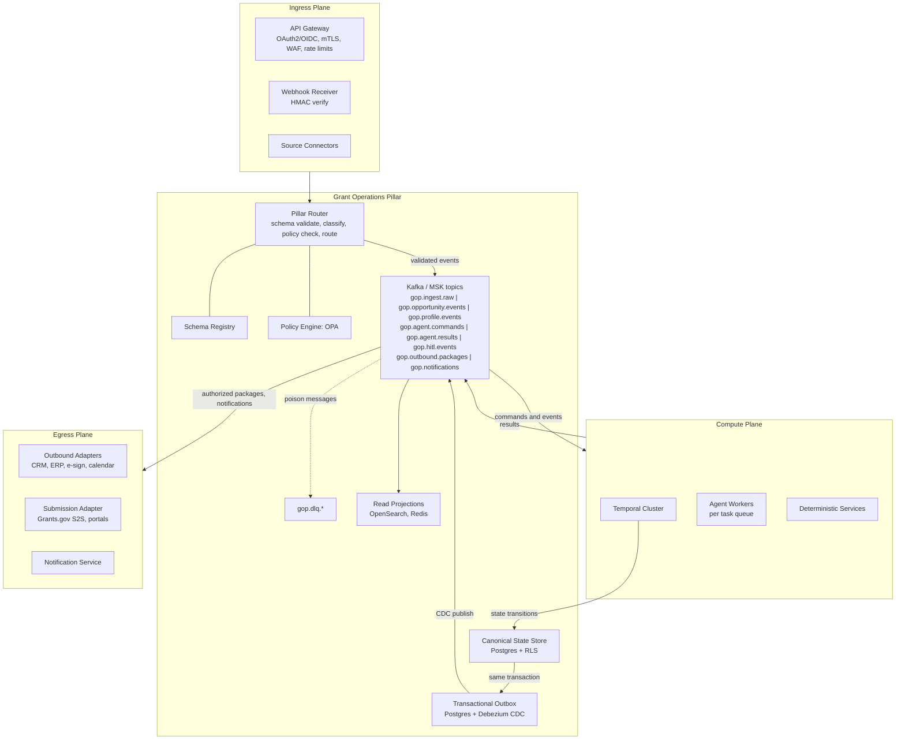

### 7.2 Topic Design

| Topic | Key (partition) | Producers | Consumers | Retention | Notes |
|---|---|---|---|---|---|
| `gop.ingest.raw` | `source:source_id` | Connectors, Router | A1 dedup, A2 parser | 30d | claim-check: payload in S3 |
| `gop.opportunity.events` | `opportunity_id` | Outbox | Temporal starter, projections, A6, CRM adapter | compacted + 1y | lifecycle and normalized events |
| `gop.profile.events` | `agency_id` | Outbox | A6, Temporal (revalidate), projections | compacted | versioned diffs |
| `gop.agent.commands` | `workflow_id` | Temporal bridge | Agent workers | 7d | used only for non-Temporal async agents (batch re-scoring) |
| `gop.agent.results` | `workflow_id` | Agent workers | Temporal bridge, audit | 30d | |
| `gop.hitl.events` | `workflow_id` | Outbox, UI | Notification, audit | 1y | gate requests and decisions |
| `gop.outbound.packages` | `opportunity_id` | Outbox | Submission, CRM, ERP adapters | 1y | **only HITL-5-authorized packages** (OPA enforces at produce time) |
| `gop.notifications` | `user_id` | Outbox | Notification service | 7d | |
| `gop.dlq.<topic>` | original | any consumer | Ops console, replay tool | 30d | carries the error and attempt count |

**Why Kafka.** Replayable log (re-run scoring when models change), ordering per opportunity, high fan-out, and mature CDC via Debezium. **Redis** is used next to it for rate limits, locks, caches and short-lived scratch state. It is never the durable bus. **RabbitMQ** is an acceptable swap for small single-region deployments behind the same `PillarPort` interface, but you lose replay.

### 7.3 Delivery Guarantees & State Persistence

1. **Transactional outbox.** A state change and its event are written in the **same Postgres transaction** (`state` table + `outbox` table). Debezium streams the outbox to Kafka. This removes dual-write inconsistencies.
2. **Idempotent consumers.** Each consumer keeps `processed_events(event_id)` with a unique constraint. Duplicates are acknowledged and skipped. Combined with the outbox, this gives effectively-once processing.
3. **Ordering.** Partitioning by `opportunity_id` / `workflow_id` gives in-order processing for each subject.
4. **Claim-check.** Payloads above 256 KB go to S3 (KMS-encrypted, per-tenant key prefix). Events carry `payload_ref` + hash.
5. **Schema governance.** Producers serialize against registry subjects. The registry enforces `BACKWARD_TRANSITIVE` compatibility. The Router rejects non-conforming messages into `gop.dlq.ingest`.
6. **Canonical state store (Postgres).** Tables: `agencies`, `agency_profile_versions` (bitemporal), `opportunities`, `opportunity_versions`, `tenant_opportunity` (per-tenant lifecycle projection), `frameworks`, `budget_ledgers`, `approvals` (append-only), `artifacts`, `outbox`, `processed_events`, `audit_log` (append-only, hash-chained). Row-Level Security on `tenant_id` for every tenant table.
7. **Workflow state** is in Temporal (its own persistence) and is mirrored to `tenant_opportunity` through outbox events, so the UI never queries Temporal directly.

### 7.4 Pillar API Contracts

**Synchronous (REST, OpenAPI 3.1, versioned under `/v1`).**

| Method & path | Purpose | Notes |
|---|---|---|
| `POST /v1/ingest/opportunities` | Push an opportunity (URL, file or structured) | Returns `202` + `ingest_id`. `Idempotency-Key` header required. |
| `POST /v1/ingest/artifacts` | Pre-signed upload for RFP files | Returns an S3 pre-signed URL. Virus scan before `raw_ingested`. |
| `GET /v1/agencies/{id}/profile` | Current profile (or `?as_of=`) | ETag / If-Match for optimistic concurrency |
| `PATCH /v1/agencies/{id}/profile` | Propose profile change | Protected fields return `202 pending_approval` (HITL-0) |
| `GET /v1/agencies/{id}/matrix` | Opportunity matrix | Cursor pagination, filters by deadline, score, status |
| `GET /v1/opportunities/{id}` | Normalized opportunity + provenance | |
| `GET /v1/workflows/{id}` | Lifecycle state, gates, timeline | Served from the projection |
| `POST /v1/workflows/{id}/signals/{gate}` | Submit a HITL decision | Body: `{decision, artifact_hash, comment}`. Rejected if the hash is stale. |
| `GET /v1/frameworks/{id}` / `POST .../recompute` | Budget framework | Recompute always goes through the Budget Engine |
| `POST /v1/packages/{id}/authorize` | HITL-5 AOR authorization | Step-up MFA required |

**Asynchronous (AsyncAPI 3.0).** Every topic in Section 7.2 is documented as an AsyncAPI channel that references the registry schemas. Consumers outside the platform (for example a customer's data warehouse) get a **filtered, tenant-scoped** export topic. They never get the internal topics.

### 7.5 Pluggable Pillar Port

If the "designated core pillar" turns out to be an existing enterprise platform, the workflow depends only on this interface:

```python
class PillarPort(Protocol):
    def publish(self, envelope: PillarEnvelope) -> None: ...  # must be outbox-backed
    def subscribe(self, event_types: list[str], group: str) -> Iterator[PillarEnvelope]: ...
    def get_state(self, entity: str, entity_id: str, as_of: datetime | None = None) -> dict: ...
    def put_state(self, entity: str, entity_id: str, state: dict, expected_version: int) -> int: ...
    def route_outbound(self, package: OutboundPackage) -> RouteReceipt: ...  # policy-checked
```

Reference implementations: `KafkaPostgresPillar` (default), `SalesforcePlatformEventsPillar` (CRM as pillar), `EventBridgeDynamoPillar` (serverless).

---

## 8. Safety, Compliance & Reliability Guardrails

### 8.1 Hallucination Prevention for Financial Figures

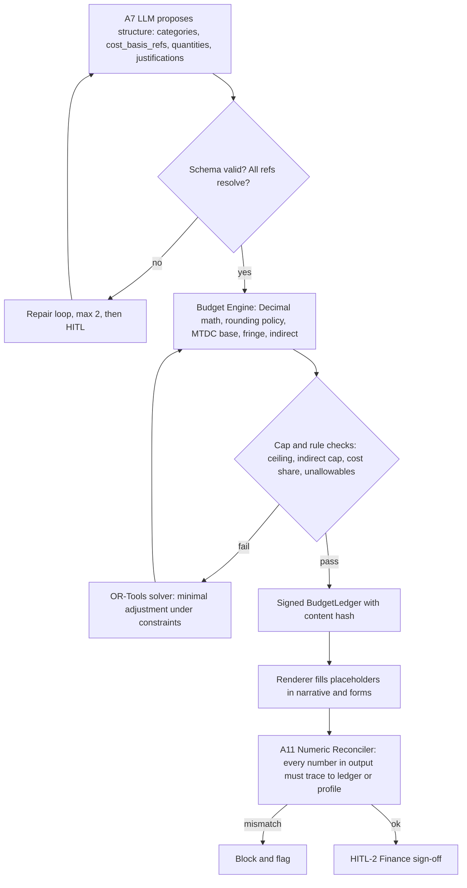

| Control | Mechanism |
|---|---|
| **No LLM arithmetic** | LLM output schemas for budgets have **no amount fields**. Only `cost_basis_ref`, `quantity`, `unit`, `effort_pct_bps`. The engine computes all amounts. |
| **Source-bound rates** | Salary, fringe and indirect rates must resolve to HRIS/ERP/profile records that carry provenance. Any `unit_rate` without a reference is rejected. |
| **Typed money** | Integers in minor units, `Decimal` with an explicit rounding mode (`ROUND_HALF_UP` per line, totals summed from rounded lines), currency checked at every operation. |
| **Rule-based caps** | Ceiling, floor, indirect cap (funder cap or the agency's NICRA / de minimis, whichever is lower), cost-share ratio, category caps, unallowable cost list. All are deterministic checks with evidence back to the RFP span. |
| **Placeholder rendering** | Narrative uses `{{ledger.totals.request_minor \| money}}`. A raw digit pattern next to a currency or "%" in LLM output is a hard fail. |
| **Numeric reconciliation** | After rendering, the verifier extracts every numeric token and maps it to a ledger, profile or RFP source. Anything unmapped fails verification. |
| **Cross-form consistency** | SF-424 item 18 totals, SF-424A, budget justification and narrative mentions are checked to be byte-identical after formatting. |
| **Property-based tests** | Hypothesis tests on the Budget Engine (sum invariants, cap monotonicity, rounding), plus a golden set of 200+ historical budgets. |

### 8.2 Grounding & Content Hallucination Controls
- **Citation-required generation:** every claim about the agency (outcomes, history, capacity) must cite a `chunk_id` or `metric_id`. Uncited factual sentences are flagged by the verifier (claim detector + NLI entailment against the cited span).
- **Approved-content-only retrieval:** A9 retrieves only chunks marked `approved_for_reuse`. Draft or unverified content is excluded.
- **Different-model verification:** A11 runs on a different model family from A9, which lowers correlated errors.
- **Confidence routing:** low confidence, high self-consistency variance or failed verification sends the item to a human reviewer. It is never auto-advanced.
- **Eval gates:** every prompt, model or rule-pack change must pass offline evals (extraction F1, alignment rank correlation, faithfulness, numeric exactness = 100%) before deployment.

### 8.3 Prompt-Injection & Untrusted-Content Defense
- Ingested RFP text, web pages and emails are wrapped as **data, not instructions** (delimited, role-separated). Agents that read untrusted content have **no side-effecting tools** (A2 is L2).
- A classifier plus heuristics flag injection patterns ("ignore previous instructions", hidden text, white-on-white, zero-width characters). The result is stored in `parse_quality.injection_suspected`. A flagged document goes to human review.
- Tool calls are checked by OPA against a per-agent allow-list. The only agent that can produce to `gop.outbound.packages` is A10, and only after the HITL-5 signal.
- Hidden or embedded text is stripped from PDFs (visibility-aware extraction), and active content (macros, JS) is quarantined.

### 8.4 Data Governance (Confidential Non-profit Data & Grantor Privacy)

| Domain | Policy |
|---|---|
| **Tenant isolation** | `tenant_id` on every row with Postgres RLS. Per-tenant KMS data keys (envelope encryption). Vector chunks carry `tenant_id` + ACL, and the filter is enforced server-side. Cross-tenant queries are impossible by construction. |
| **Classification** | Every artifact and field is labelled `public` / `internal` / `confidential` / `restricted` (for example client PII, HR data, donor data). Restricted data never reaches an LLM without redaction (Presidio + custom recognizers for client case data). |
| **LLM data handling** | Enterprise endpoints with **zero data retention** and no training on inputs. Region pinning per tenant. Model Gateway logs only hashes and metadata by default. Prompt and response bodies are retained only in a tenant-controlled, encrypted debug store with a TTL. |
| **Training & learning** | No cross-tenant training on confidential data. Global models learn only from public data (funder graph) and from **opt-in**, de-identified aggregate signals. Per-tenant style adapters need explicit opt-in (`allow_style_finetune`) and are deleted on offboarding. |
| **Grantor privacy** | Reviewer comments, funder contact data and non-public funder communications are tenant-confidential. Licensed datasets (for example Candid) are only shown within their licence scope. Contact data follows CAN-SPAM / GDPR purpose limits. |
| **Access control** | RBAC (roles from SCIM groups) + ABAC (OPA: classification x role x gate). Step-up MFA for HITL-2/3/5 and for exports. Just-in-time admin access with session recording for support staff. |
| **Audit** | Append-only, hash-chained `audit_log` of every read of restricted data, every model call (metadata), every approval and every outbound package. It can be exported for single audits. |
| **Retention & deletion** | Retention per tenant. Crypto-shredding on deletion (destroy the tenant key). Legal hold support. |
| **Compliance frameworks** | SOC 2 Type II controls baseline. GDPR/CCPA DSAR workflows. 2 CFR 200 recordkeeping (keep award records at least 3 years after closeout). HIPAA BAA path for health-services tenants that keep PHI out of narrative inputs. |

### 8.5 Error Handling & Fallback Routes for Malformed RFTs

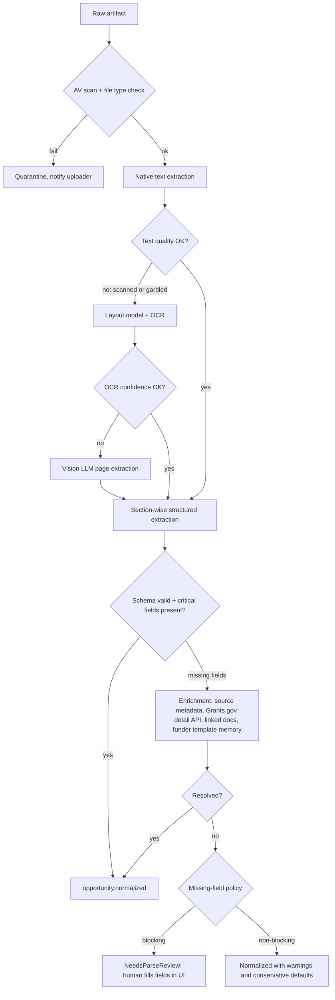

**Missing-parameter policy:**

| Missing / malformed field | Classification | Fallback behaviour |
|---|---|---|
| Application deadline | **Blocking** | No recommendation is shown as `pursue`. Human must confirm. If only a date is given (no time), assume 11:59 PM in the funder's timezone, but set the internal deadline 72h earlier and flag it. |
| Timezone | Non-blocking | Use the funder's HQ timezone (from the funder graph), then the earliest plausible US timezone (ET), and flag it. |
| Award ceiling | Non-blocking for ranking, **blocking for budgeting** | Ranking uses the historical median for the funder or program. A7 cannot start until a human enters or confirms the ceiling. |
| Indirect cost policy | Non-blocking | Assume the most restrictive plausible value (indirect not allowed) until clarified. The question goes into a "questions to funder" list. |
| Eligibility clauses unparseable | Needs review | `needs_review` status. Never auto-`ineligible` and never auto-`eligible`. |
| Required sections / page limits absent | Non-blocking | Use the funder template memory, otherwise a generic NOFO template, marked as assumed. |
| Conflicting values (for example two deadlines) | **Blocking** | Show both with evidence spans. The human picks one. The conflict is logged for template-memory learning. |
| Amendment detected | Re-process | Diff against the previous version. Affected states roll back (Section 4.3). Owners are notified with a red-line. |
| Corrupt / password-protected file | Blocking | Quarantine. Ask the uploader or re-fetch from the source. |

**Runtime reliability:**
- **Retries:** activity-level exponential backoff with jitter, plus per-error-class policies (no retry on schema violations, retry on 429 and 5xx).
- **Circuit breakers** per external source and per LLM provider. The Model Gateway fails over to a secondary provider of the same tier. If all providers fail, the workflow pauses (it is durable) and does not degrade quietly.
- **DLQ + replay console:** failed events keep their full context. Ops can replay them after a fix. Replays are idempotent.
- **Budgets:** per-run token, cost and step ceilings. Going over a ceiling stops the run and sends it to a human. It never loops unbounded.
- **Deadline safety:** if any agent dependency is degraded within T-72h of a deadline, the workflow raises priority (dedicated worker pool) and alerts the owner with a manual fallback kit.

---

## 9. Recommended Tech Stack Primitives

| Layer | Primary choice | Alternatives | Rationale |
|---|---|---|---|
| Durable orchestration | **Temporal** (Cloud or self-hosted) | AWS Step Functions | Signals for HITL, long timers, versioned workflows |
| Agent graphs | **LangGraph** (Python) | Pydantic-AI, custom | Checkpointing, interrupts, typed state |
| Event backbone | **Apache Kafka (AWS MSK)** + Debezium | Redpanda, RabbitMQ (small deployments) | Replay, ordering, CDC |
| Cache / locks / rate limits | **Redis (ElastiCache)** | Valkey | |
| System of record | **PostgreSQL 16 (Aurora)** with RLS | | Strong consistency, RLS, JSONB |
| Vector store | **pgvector** (HNSW) | Qdrant / Weaviate past about 50M chunks | Same transaction and ACL model as the SoR at the start |
| Search / projections | **OpenSearch** | Typesense | Faceted opportunity search, BM25 for hybrid RAG |
| Object storage | **S3** + KMS, Object Lock for audit artifacts | | Immutable raw artifacts |
| Document parsing | pdfplumber, python-docx, **Docling / Unstructured**, **AWS Textract** | Azure Document Intelligence | Layout-aware, table extraction |
| LLM access | **Model Gateway** (LiteLLM-style) to frontier models from 2+ vendors (for example Anthropic Claude, OpenAI GPT, Google Gemini) + open models (Llama / Qwen class) on vLLM for fine-tuned small tasks | AWS Bedrock as aggregator | Failover, residency, cost routing |
| Embeddings / rerank | Hosted embedding model + cross-encoder reranker (for example bge-reranker) | Cohere Rerank | |
| Structured output | JSON-schema-constrained decoding / function calling, **Pydantic** models | Outlines, Instructor | |
| Rules / policy | **OPA (Rego)** + JSON Logic | Cedar | Auditable, testable rules |
| Optimization | **Google OR-Tools** | PuLP | Budget constraint solving, capacity knapsack |
| ML ranking | **LightGBM** (LambdaMART), scikit-learn calibration | XGBoost | |
| PII / DLP | **Microsoft Presidio** + custom recognizers | AWS Macie (S3) | |
| AuthN / AuthZ | **OIDC (Auth0 / Okta / Cognito)**, SCIM, OPA | Keycloak | |
| API | FastAPI services, OpenAPI 3.1, AsyncAPI 3.0, Kong / AWS API Gateway | | |
| Frontend | Next.js + TypeScript, TipTap collaborative editor (Yjs), approval inbox | | |
| Observability | **OpenTelemetry**, Grafana / Prometheus / Tempo, **Langfuse** for LLM traces & evals | Datadog, LangSmith | End-to-end trace via `trace_id` in the envelope |
| Infra | Kubernetes (EKS), Terraform, ArgoCD, KEDA (scale workers on queue lag) | ECS | |
| Secrets | AWS Secrets Manager / HashiCorp Vault | | Per-tenant integration credentials |

---

## 10. Evaluation, Observability & SLOs

### 10.1 Offline Evaluation Suite (CI gate)

| Capability | Dataset | Metric | Release threshold |
|---|---|---|---|
| RFP extraction (A2) | 500 labelled NOFOs/RFPs across 60 funders, including scanned and malformed ones | Field-level F1. Deadline exact-match. | F1 at least 0.93. Deadline exact-match at least 0.99. |
| Eligibility (A4) | 1,000 agency x opportunity pairs | False-ineligible rate (missed opportunities) | at most 1% |
| Alignment (A5) | Expert-ranked pairs | Spearman vs. expert ranking. Calibration ECE. | at least 0.70; ECE at most 0.08 |
| Recommendation (A6) | Historical pursue/win logs | NDCG@10, Recall@20 of eventually-pursued | +5% over baseline before swapping weights |
| Budget (A7 + engine) | 200 historical budgets | Numeric exactness, cap violations | **100% exact, 0 violations** |
| Narrative (A9) | Rubric-scored drafts | Faithfulness (NLI), criterion coverage, reviewer rubric score | faithfulness at least 0.98, coverage 100% |
| Injection robustness | Red-team corpus | Attack success rate | 0 side-effect escapes |

### 10.2 Online Metrics & SLOs

| SLO | Target |
|---|---|
| New federal opportunity to normalized and scored, for all matching tenants | p95 under 2h from Grants.gov publication (bounded by connector cadence) |
| Pillar event end-to-end latency (outbox to consumer) | p99 under 5s |
| API availability | 99.9% monthly |
| Workflow durability | 0 lost workflows (Temporal), RPO 5 min, RTO 1h |
| HITL notification delivery | p95 under 60s |
| Missed internal deadline caused by the platform | 0 per quarter |

Business KPIs: hours saved per application, pursue-to-submit conversion, win rate vs. agency baseline, dollars awarded per staff hour, recommendation acceptance rate.

---

## 11. Deployment Topology

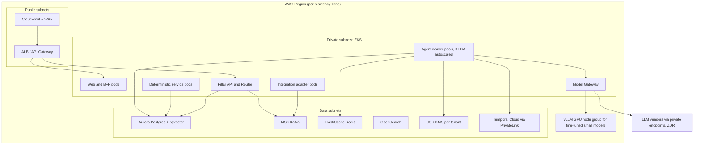

---

## 12. Phased Delivery Roadmap

| Phase | Duration | Scope | Exit criteria |
|---|---|---|---|
| **P0 Foundations** | 6 weeks | Pillar (Kafka, outbox, registry, Postgres RLS), Temporal skeleton, Agency Profile (A3) + onboarding, Grants.gov connector, A2 v1 (native + layout), audit log | 50 real NOFOs normalized at F1 at least 0.85. Profile for 3 design-partner agencies. |
| **P1 Match** | 6 weeks | A4 rules, A5 alignment, A6 heuristic ranking, opportunity matrix UI, HITL-1, notifications, SAM.gov checks | Design partners accept at least 30% of "pursue" recommendations |
| **P2 Plan** | 6 weeks | Budget Engine + A7 + solver, HITL-2, ERP/HRIS adapters, A11 verifier (numeric) | 100% numeric exactness on the golden set. Finance sign-off flow live. |
| **P3 Produce** | 8 weeks | A9 narrative + collaborative editor, A8 compliance packs, HITL-3/4, CRM sync, e-sign | First full application produced end-to-end and submitted manually by an AOR |
| **P4 Submit & Learn** | 8 weeks | A10 packaging + Grants.gov S2S, HITL-5, foundation connectors (Candid, funder sites), outcome capture, LTR model, style adapters (opt-in) | First S2S submission. LTR beats heuristic offline. |
| **P5 Scale & Certify** | ongoing | SOC 2 Type II, multi-region residency, post-award reporting agent, state portal connectors | SOC 2 report. 100+ tenants. |

---

## 13. Open Decisions for Leadership

1. **Core Pillar identity (A1):** confirm that the Grant Operations Pillar is ours, or name the existing enterprise pillar (for example the agency's Salesforce org) to put behind `PillarPort`.
2. **Submission automation level:** keep v1 at "AOR-authorized, platform-submitted via S2S" (recommended), or limit it to manual-kit only.
3. **Licensed data:** whether to buy a platform-wide Candid licence or bring-your-own-licence per tenant.
4. **Self-hosted model footprint:** GPU node group for fine-tuned small models (cost vs. per-token savings past about 2M extraction calls a month).
5. **Cross-tenant learning:** policy for opt-in, de-identified outcome signals to improve win-probability models for small agencies with little history.

---

## Appendix A. Agent Interaction Contract (LangGraph inner loop, reference)

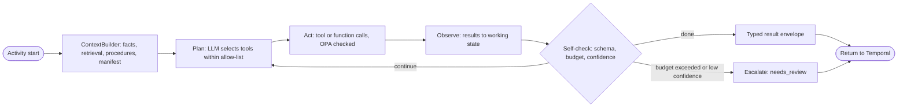

## Appendix B. Temporal Workflow Skeleton (illustrative)

```python
@workflow.defn
class OpportunityLifecycleWorkflow:
    @workflow.run
    async def run(self, tenant_id: str, opportunity_id: str) -> Outcome:
        opp = await act(load_opportunity, opportunity_id)
        elig = await act(eligibility_agent, tenant_id, opp, queue="q.eligibility")
        if elig.status == "ineligible":
            return await self.close("Ineligible", elig)
        if elig.status == "needs_review":
            await self.gate("HITL-ELIG", payload=elig)

        align = await act(alignment_agent, tenant_id, opp, queue="q.align")
        rank = await act(recommend_agent, tenant_id, opp, align, queue="q.recommend")
        if rank.recommendation in ("watch", "skip"):
            return await self.close("Archived", rank)

        go = await self.gate("HITL-1", payload=rank, deadline=opp.internal_deadline)
        if go.decision != "GO":
            return await self.close("Declined", go)

        framework = await self.loop_until_approved(
            produce=lambda fb: act(budget_agent, tenant_id, opp, go, fb, queue="q.budget"),
            verify=lambda f: act(verifier_agent, f, queue="q.verify"),
            gate="HITL-2",
        )
        draft = await self.loop_until_approved(
            produce=lambda fb: act(narrative_agent, tenant_id, opp, framework, fb, queue="q.draft"),
            verify=lambda d: act(verifier_agent, d, queue="q.verify"),
            gate=None,
        )
        await self.loop_until_approved(
            produce=lambda fb: act(
                compliance_agent, tenant_id, opp, draft, fb, queue="q.compliance"
            ),
            verify=None,
            gate="HITL-3",
        )
        await self.gate("HITL-4", payload=draft)
        package = await act(packaging_agent, tenant_id, opp, framework, draft, queue="q.package")
        await self.gate("HITL-5", payload=package, step_up_mfa=True)
        receipt = await act(submit_package, package, queue="q.submit")
        return await self.close("Submitted", receipt)
```

*End of specification.*
