# Hope specs

Spec-driven development for Hope. Every feature and every screen has a spec here, with
everything an agent needs to build it: the behaviour, the acceptance criteria, the tests,
the exact files it may touch, the contracts and endpoints, and its dependencies.

**To build something, tell an agent:** "Implement spec `S07` from `docs/specs/` in carolbonk/hope."
The agent reads this README, `FOLDERS.md`, the spec, and every spec it links. Then it opens
one PR that touches only the paths the spec owns.

| File | What it holds |
|---|---|
| [`FOLDERS.md`](FOLDERS.md) | Target folder layout and who owns each path |
| [`API.md`](API.md) | Every `/v1` endpoint: owning spec, status, and the screens that call it |
| [`SCREENS.md`](SCREENS.md) | Every screen: route, implementing spec, endpoints it calls |
| [`features/`](features) | Feature specs `S00`-`S31` |
| [`screens/`](screens) | Screen specs `SC01`-`SC23` |
| [`templates/`](templates) | Templates for new feature and screen specs |

## Rules for implementing a spec

1. **Check the dependencies first.** Every spec in the spec's `Depends on` list must be `Done`
   in the status table below. If one isn't, stop and report.
2. **Touch only what the spec owns.** The spec's `Owns` list is the full set of paths the PR
   may create or change. If you need anything else (for example a change in `hope_core`, a
   shared UI primitive, or another spec's folder), don't make it. Add it under "Requests"
   in the PR description and stop. This is what keeps parallel PRs free of merge conflicts.
3. **Use the migration numbers reserved for the spec** (listed in the spec and in the table below).
4. **Contracts live in `hope_core.schemas`.** A spec never defines a shared model itself.
   All shared contract changes for a wave go into that wave's contracts spec (`S00` for
   wave 1; `C2`, `C3`, `C4` are added before waves 2-4).
5. **Settings.** New configuration goes in a `BaseSettings` class in the spec's own folder,
   with the `HOPE_` env prefix, not in `hope_core/settings.py`.
6. **Lockfiles.** If `uv.lock` or `pnpm-lock.yaml` conflicts, take `main`'s version and rerun
   `uv lock` / `pnpm install`.
7. **Every acceptance criterion maps to a test** named in the spec's test plan. All CI commands
   in `AGENTS.md` must pass. Tests run offline with mocks (no API keys).
8. **Screens follow the design system.** Use the neumorphic primitives in
   `apps/web/src/components/ui` (`neu-raised`, `neu-inset`, `neu-pressed`), with WCAG AA
   contrast, visible focus rings, status shown by icon or text and not only by colour, and
   `prefers-reduced-motion` support.
9. **Done means:** the PR is merged, CI is green, and the spec's status row is set to `Done` in the same PR.

## Product decisions that apply to every spec

- **The MVP is single-tenant: one organization per deployment.** The `tenant_id` columns and
  row-level security stay in the database (already built), but the server always uses the one
  tenant set in `HOPE_TENANT_ID`. No spec adds tenant IDs to URLs, tenant headers from the
  client, a tenant picker or switcher, or per-tenant settings. The MVP has one agency;
  `GET /v1/me` returns its `agency_id`, and the `agency_id` path segments stay so that
  multi-tenant can be added later without changing URLs.
- Hope is free for nonprofits to use. Paid hosting, LLM and other services behind it are fine.
- LLMs suggest; deterministic code decides eligibility, money, deadlines, state transitions
  and submission. No LLM output contains a money amount.
- Every approval is bound to the exact artifact hash; any change voids it (HTTP 409).
- Nothing is submitted to a funder without HITL-5 approval by the authorized representative.
- Cost-share lines are excluded from every indirect-cost base.

## Waves

Specs in the same wave touch disjoint paths and can run in parallel. A wave starts when
every spec it depends on is `Done`.

```mermaid
flowchart LR
  S00[S00 contracts + scaffolding] --> W1
  subgraph W1[Wave 1]
    S01 & S02 & S03 & S04 & S05 & S06 & S07 & S09 & S10 & S11 & S12 & S13 & S16 & S28 & S29
  end
  W1 --> C2[C2 contracts] --> W2
  subgraph W2[Wave 2]
    S08 & S14 & S15 & S17 & S18 & S19 & S24 & S27 & S30 & S31
  end
  W2 --> C3[C3 contracts] --> W3
  subgraph W3[Wave 3]
    S20 & S21 & S23 & S25 & S26
  end
  W3 --> C4[C4 contracts] --> W4
  subgraph W4[Wave 4]
    S22
  end
```

## Status

Status values: `Draft` (the spec is being written), `Ready` (reviewed; can start once its
dependencies are Done), `In progress` (there is a PR), `Done`.

| Spec | Title | Wave | Depends on | Migrations | Screens | Status |
|---|---|---|---|---|---|---|
| [S00](features/S00-shared-contracts-and-scaffolding.md) | Shared contracts and scaffolding | 0 | - | `0002` | - | Ready |
| S01 | Sign-in, users, roles and `/v1/me` (single tenant) | 1 | S00 | `0110` | SC01, SC17 | Draft |
| S02 | Approval inbox API and screens | 1 | S00 | - | SC05, SC06 | Draft |
| S03 | Opportunity search and detail | 1 | S00 | - | SC04 | Draft |
| S04 | Pursue, workflow list and history | 1 | S00 | `0610` | SC07, SC08 | Draft |
| S05 | Matrix explainability and disposition | 1 | S00 | `0410` | SC03 | Draft |
| S06 | Budget API and HITL-2 budget review | 1 | S00 | `0510` | SC13 | Draft |
| S07 | Wire real agents into the lifecycle workflow | 1 | S00 | - | - | Draft |
| S09 | Profile hardening and onboarding via HITL-0 | 1 | S00 | `0310` | SC09, SC10, SC11 | Draft |
| S10 | Scheduled discovery and parse-review queue | 1 | S00 | `0210` | SC12 | Draft |
| S11 | OCR engine for scanned documents | 1 | S00 | - | - | Draft |
| S12 | Notification delivery and notification centre | 1 | S00 | `0700` | SC16 | Draft |
| S13 | Audit trail API and screen | 1 | S00 | `0120` | SC15 | Draft |
| S16 | Real LLM and embedding providers, usage metering | 1 | S00 | `0010` | - | Draft |
| S28 | Cloud environments, IaC and deploy pipeline | 1 | S00 | - | - | Draft |
| S29 | Observability and LLM cost tracking | 1 | S00 | - | - | Draft |
| S08 | Persistent matching state and rule approval | 2 | S05 | `0420` | SC14 | Draft |
| S14 | USAspending past-awards signal | 2 | S05, S10 | `0220`, `0430` | - | Draft |
| S15 | IRS exempt-org and 990 import | 2 | S09 | `0320` | - | Draft |
| S17 | Narrative drafting agent | 2 | S16, S06 | `0800` | - | Draft |
| S18 | Verifier: claims, citations and numbers | 2 | S16, S06 | `0900` | - | Draft |
| S19 | Compliance packs and HITL-3 attestation | 2 | S06 | `1000` | SC20 | Draft |
| S24 | Integrations framework and CRM connector | 2 | S01 | `1300` | SC18 | Draft |
| S27 | Foundation and state portal connectors | 2 | S10, S11 | `0230` | - | Draft |
| S30 | Security hardening: secrets, AV, backups, WAF | 2 | S28 | - | - | Draft |
| S31 | Dashboard | 2 | S02, S04, S05 | - | SC02 | Draft |
| S20 | Proposal workspace and HITL-4 executive approval | 3 | S17, S18, S19 | - | SC19, SC21 | Draft |
| S21 | Application package assembly | 3 | S18, S19 | `1100` | SC22 | Draft |
| S23 | Post-award tracking and outcome loop | 3 | S04 | `1400` | SC23 | Draft |
| S25 | ERP / accounting connector for cost basis | 3 | S24, S06 | `1310` | - | Draft |
| S26 | Calendar sync for deadlines | 3 | S24, S12 | `0710` | - | Draft |
| S22 | Grants.gov S2S submission and status | 4 | S21 | `1200` | - | Draft |

Open decisions that block specific specs are listed in each spec under "Decisions needed".
